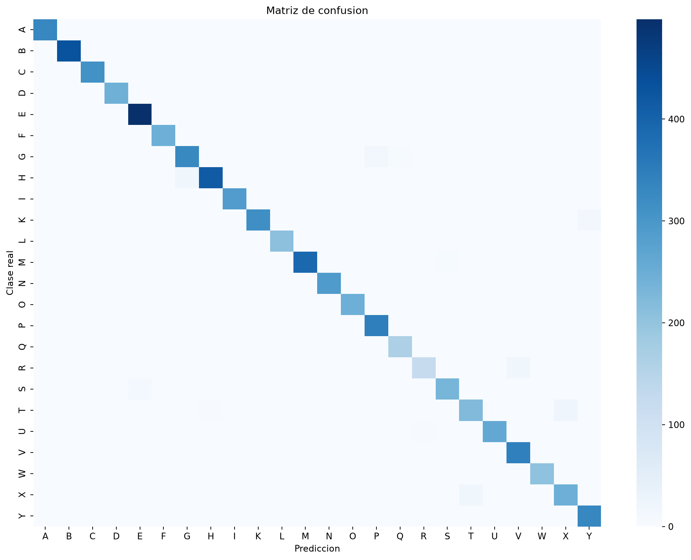
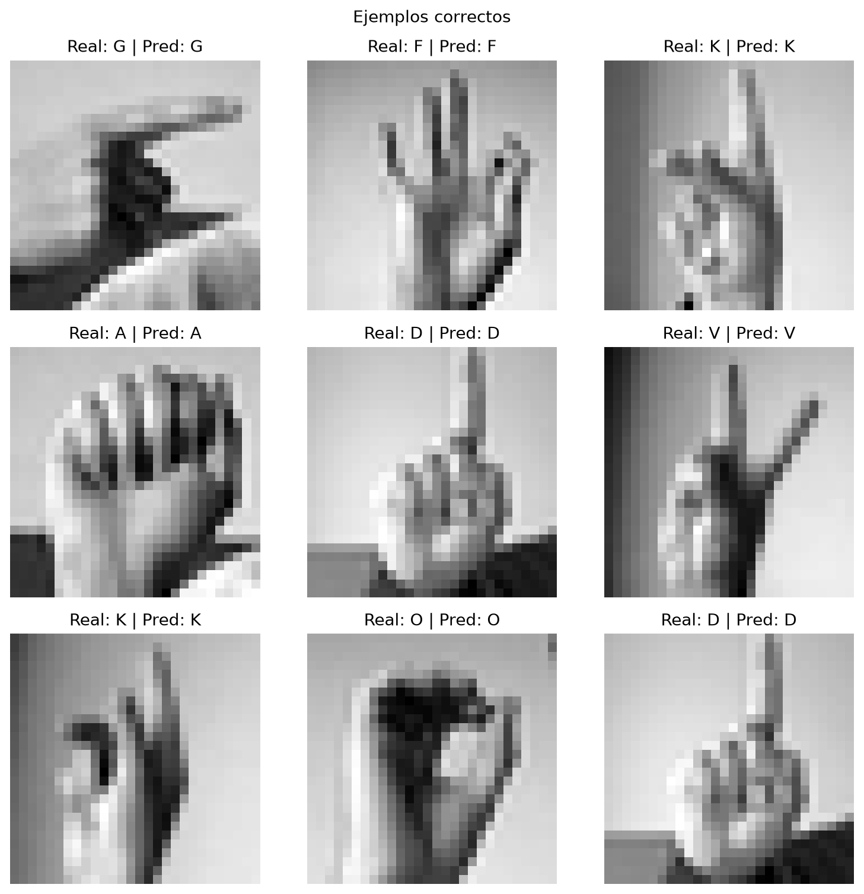
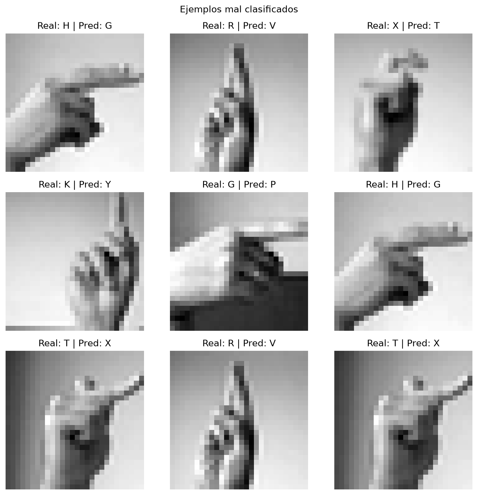
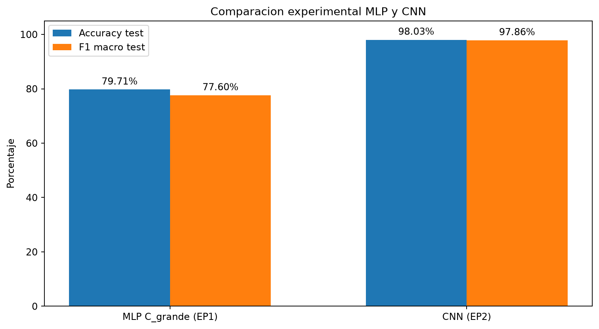

# Informe tecnico EP2: clasificacion de lenguaje de senas con CNN

## 1. Integrantes y objetivo

**Integrantes:** Gonzalo Castillo, Jenaro Marin y Jason Aguilera.

El objetivo de la EP2 es implementar una red neuronal convolucional (CNN) para
resolver el mismo problema multiclase de la EP1 y comparar objetivamente su
desempeno con el MLP desarrollado anteriormente.

El caso corresponde al reconocimiento de letras estaticas del alfabeto ASL a
partir de imagenes de manos. Una aplicacion posible es apoyar herramientas
educativas o de accesibilidad que necesiten identificar una sena individual.

### Division de redaccion, evidencias y defensa

El informe se organiza por bloques completos para distribuir de forma
equilibrada la redaccion, la revision tecnica y la defensa oral. Cada
integrante debe revisar que sus secciones coincidan con el notebook, las
figuras y los resultados finales del repositorio.

| Responsable | Secciones del informe | Trabajo que debe dejar listo |
| --- | --- | --- |
| Gonzalo Castillo | 1. Objetivo; 2. Continuidad; 3. Datos y preparacion | Explicar el caso, justificar la continuidad con la EP1, verificar dataset, clases, particiones, semilla 42, normalizacion y conversion de vector de 784 valores a tensor `(28, 28, 1)`. |
| Jenaro Marin | 4. Arquitectura; 5. Entrenamiento e interpretabilidad | Justificar capas convolucionales, pooling, ReLU, softmax, perdida, Adam, Dropout y callbacks; comprobar curvas, Feature Maps y Grad-CAM. |
| Jason Aguilera | 6. Evaluacion; 7. Comparacion; 8. Limitaciones; 9. Conclusiones | Verificar metricas, matriz de confusion, errores por clase y ejemplos; comparar CNN con MLP y redactar limitaciones, mejoras y conclusiones. |
| Trabajo compartido | 10. Reproducibilidad y aportes | Ejecutar o revisar el flujo completo, comprobar que informe, README, notebook y PPT usen la misma corrida, y preparar respuestas para preguntas cruzadas. |

Antes de entregar, cada responsable debe confirmar lo siguiente:

- **Gonzalo:** las cantidades `21.964 / 5.491 / 7.172`, las 24 clases y la
  transformacion `(784) -> (28, 28, 1)` coinciden en todo el proyecto.
- **Jenaro:** la arquitectura suma 243.352 parametros y las figuras de
  entrenamiento e interpretabilidad pertenecen a la corrida seleccionada.
- **Jason:** la evaluacion final usa 7.172 imagenes, 7.031 aciertos, 141
  errores, 98,03% de accuracy y 0,9786 de F1 macro.
- **Los tres:** la entrega final usa la corrida ubicada en `output/jason_ep2/`
  y la presentacion `Sign_Language_MNIST_CNN_EP2_FINAL_10_MIN.pptx`.

## 2. Continuidad y variante seleccionada

Se reutiliza el dataset **Sign Language MNIST** y se conserva la variante de
clasificacion multiclase de 24 letras. Esta decision permite que la diferencia
principal entre los experimentos sea el tipo de red: MLP en la EP1 y CNN en la
EP2.

La comparacion es pertinente porque el MLP recibe un vector plano y no modela
explicitamente la cercania entre pixeles. La CNN conserva la estructura 2D de
la imagen y aprende filtros locales que detectan bordes, contornos y patrones
de mayor nivel.

## 3. Datos y preparacion para la CNN

Los archivos `sign_mnist_train.csv` y `sign_mnist_test.csv` contienen una
columna `label` y 784 columnas de intensidad. Cada fila representa una imagen
de 28 x 28 pixeles en escala de grises.

Esta etapa no repite la limpieza ni el EDA completo realizado en la EP1. Se
reutiliza el conjunto ya validado y se documentan solamente las verificaciones
y transformaciones necesarias para cambiar desde la entrada plana del MLP al
formato tensorial requerido por la CNN.

El conjunto incluye 24 clases: A-I y K-Y. J y Z se excluyen porque sus senas
requieren movimiento, mientras que el dataset contiene imagenes estaticas.

Se aplicaron los siguientes pasos:

1. Lectura de los CSV y separacion de pixeles y etiquetas.
2. Division estratificada del archivo de entrenamiento en 21.964 imagenes de
   entrenamiento y 5.491 de validacion.
3. Conservacion de las 7.172 imagenes del test oficial para la evaluacion final.
4. Normalizacion de cada pixel dividiendo por 255, desde el rango 0-255 al
   rango 0-1.
5. Reconstruccion de cada fila como tensor `(28, 28, 1)`, donde el ultimo valor
   representa el canal de escala de grises.

La estratificacion mantiene aproximadamente la proporcion de las 24 clases en
entrenamiento y validacion. No hay etiquetas fuera del mapeo esperado ni
pixeles fuera del rango valido. No se utilizo data augmentation en esta version
para mantener una comparacion simple y reproducible; puede incorporarse en un
experimento posterior.

## 4. Arquitectura y decisiones de diseno

La arquitectura implementada es:

| Etapa | Configuracion | Justificacion |
| --- | --- | --- |
| Entrada | 28 x 28 x 1 | Conserva la estructura espacial de la imagen gris. |
| Bloque 1 | Conv2D 32, 3x3, ReLU + MaxPool 2x2 | Aprende patrones locales basicos y reduce dimensiones. |
| Bloque 2 | Conv2D 64, 3x3, ReLU + MaxPool 2x2 | Combina bordes en formas mas complejas. |
| Regularizacion | Dropout 0,25 | Reduce coadaptacion entre activaciones. |
| Bloque 3 | Conv2D 128, 3x3, ReLU + MaxPool 2x2 | Aprende representaciones de mayor nivel. |
| Clasificador | Flatten + Dense 128 ReLU + Dropout 0,40 | Integra las caracteristicas antes de clasificar. |
| Salida | Dense 24, softmax | Produce una probabilidad para cada clase. |

Las convoluciones usan `padding="same"` y paso 1: mantienen el alto y ancho
antes del pooling. El flujo espacial es 28x28 -> 14x14 -> 7x7 -> 3x3; el
ultimo pooling usa ventanas completas, por lo que 7 se reduce a 3. `Flatten`
convierte 3x3x128 activaciones en 1.152 valores para la capa densa.

Un filtro 3x3 aprende relaciones locales con pocos pesos. Los filtros se
comparten en todas las posiciones; por ejemplo, la primera convolucion usa
(3x3x1 + 1)x32 = 320 parametros, incluidos los sesgos. El crecimiento
32 -> 64 -> 128 aumenta la cantidad de patrones disponibles mientras el
pooling reduce el costo espacial. Es una decision de diseno de esta version,
no el resultado de una busqueda que demuestre una arquitectura optima.

ReLU calcula `max(0, x)` e introduce no linealidad entre las capas. Softmax
normaliza las 24 salidas para elegir una clase mutuamente excluyente. El MLP
conserva los valores de los pixeles al aplanar, pero sus capas densas no
incorporan esta estructura de filtros locales compartidos.

Se uso `sparse_categorical_crossentropy` porque las etiquetas se conservan como
indices enteros contiguos de 0 a 23, y el problema tiene una sola clase
correcta por imagen. El mapeo a las etiquetas originales se conserva para
mostrar las letras; no se utiliza one-hot en la CNN. No se
uso perdida binaria porque las clases son mutuamente excluyentes y existen 24
posibles resultados.

El optimizador fue Adam con learning rate inicial de 0,001, batch de 128 y un
maximo de 20 epocas. Adam mantiene estimaciones del promedio y de la magnitud
de los gradientes para adaptar las actualizaciones por parametro. El batch
produce 172 actualizaciones por epoca, incluida la ultima incompleta.

`EarlyStopping` observa `val_loss`, con paciencia de 4 epocas y restauracion
de los mejores pesos. `ReduceLROnPlateau` observa la misma perdida y reduce
el learning rate a la mitad tras 2 epocas sin mejora suficiente, con minimo
de 0,00001. Ambos callbacks usan sus umbrales predeterminados de mejora, que
no son identicos. Dropout usa tasas de 0,25 y 0,40 solo durante el entrenamiento;
en inferencia y validacion se desactiva. La semilla 42 y las operaciones
deterministas facilitan repetir una corrida dentro del mismo entorno. Cambios
de versiones o hardware pueden modificar numeros y tiempos.

## 5. Entrenamiento e interpretabilidad

La ejecución utilizada para el cierre es la de Jason, guardada en `output/jason_ep2/`. La CNN conserva los 243.352 parámetros y completó 20 épocas en 137,20 segundos, con 100 % de accuracy de validación. Los estados del optimizador Adam no representan parámetros adicionales de la arquitectura. Las corridas anteriores de 41,41 s y 127,95 s se conservan como antecedentes en sus ubicaciones originales.

La pérdida de entrenamiento disminuyó de 2,3849 a 0,0170 y el accuracy aumentó de 27,04 % a 99,45 %. La menor pérdida de validación se obtuvo en la época 19, con valor 0,0000242964; el entrenamiento completó las 20 épocas y restauró los pesos de la época 19. No hubo parada anticipada. El historial conserva las tasas de aprendizaje utilizadas en cada época.

Dropout actúa durante entrenamiento y se desactiva en validación e inferencia. Esto y la acumulación de métricas mientras cambian los pesos ayudan a interpretar diferencias entre las curvas. Las curvas no bastan para demostrar robustez externa; la sección 6 evalúa el test oficial.

Los Feature Maps muestran los primeros ocho canales de `conv_1`, `conv_2` y
`conv_3`, junto a la imagen original. Sus resoluciones son 28x28, 14x14 y 7x7
antes del pooling correspondiente. Las respuestas pueden asociarse a
contrastes, contornos y combinaciones mas selectivas; no se asigna un
significado fijo a cada filtro a partir de una sola imagen.

Grad-CAM pondera estos mapas con el gradiente del puntaje de una clase antes
de softmax, sin cambiar el clasificador. Los mapas 7x7 se amplian y se
superponen a la imagen para localizar las activaciones. Se explican tanto
aciertos como errores para la clase predicha. Ademas se exporta un panel de
las 24 clases, con una muestra por clase real y Grad-CAM dirigido a esa clase.
La seleccion toma el primer acierto disponible, o el primer error si no hay
aciertos. Cada mapa se normaliza por separado: sus colores no permiten
comparar confianza entre imagenes y no prueban causalidad. Las activaciones
pueden incluir partes de la mano y tambien bordes o fondo.

Evidencia de la ejecución utilizada:

- `output/jason_ep2/reports/cnn_history.csv`
- `output/jason_ep2/reports/cnn_model_summary.txt`
- `output/jason_ep2/images/cnn_training_curves.png`
- `output/jason_ep2/images/cnn_feature_maps.png`
- `output/jason_ep2/images/cnn_gradcam_examples.png`
- `output/jason_ep2/images/cnn_gradcam_by_class.png`

La implementación de Jenaro conserva la exportación compartida entre script y notebook y los mapas de las 24 clases. Su ejecución anterior permanece en `output/jenaro_ep2/`. La ejecución de Jason utiliza esa implementación sin cambiar la arquitectura ni ajustar parámetros con el test.

## 6. Evaluación en test

El cierre utiliza la ejecución de Jason guardada en `output/jason_ep2/`. Sus métricas, figuras, predicciones y notebook ejecutado corresponden a la misma corrida, con semilla 42 y la arquitectura CNN de 243.352 parámetros. Las ejecuciones anteriores de 96,60 % y 96,81 % se conservan como antecedentes y no se combinan con estos resultados.

### 6.1 Métricas globales

El test oficial contiene 7.172 imágenes separadas de entrenamiento y validación. La predicción es la clase de mayor probabilidad softmax, convertida a su letra mediante el mapeo del proyecto.

| Métrica | CNN de Jason | Interpretación |
| --- | ---: | --- |
| Accuracy de test | 98,03 % | Porcentaje total de imágenes con la clase correcta. |
| Precisión macro | 0,9804 | Promedio de precisión por letra. |
| Recall macro | 0,9773 | Promedio de recuperación de ejemplos reales por letra. |
| F1 macro | 0,9786 | Promedio del equilibrio entre precisión y recall de cada letra. |
| Aciertos | 7.031 | Predicciones correctas de 7.172. |
| Errores | 141 | Predicciones diferentes de la clase real. |

Accuracy se calcula como 7.031 / 7.172. Para cada clase, precisión = VP / (VP + FP), recall = VP / (VP + FN) y F1 = 2 × precisión × recall / (precisión + recall). El promedio macro asigna el mismo peso a las 24 letras. Se promedian los F1 individuales; el F1 macro no se calcula directamente desde precisión macro y recall macro.

Las métricas macro complementan el accuracy porque el test contiene cantidades distintas por letra: E tiene 498 imágenes y R tiene 144. El resultado describe este test y no implica el mismo rendimiento con cualquier cámara o persona.

### 6.2 Matriz de confusión y errores por clase

Las filas indican la clase real y las columnas la predicción. La diagonal suma los 7.031 aciertos y las celdas restantes suman los 141 errores. Los siguientes conteos se recalcularon desde el modelo guardado y se exportaron como CSV; ya no dependen de leer una figura.

| Letra real | Predicción incorrecta | Casos |
| --- | --- | ---: |
| T | X | 22 |
| R | V | 21 |
| X | T | 21 |
| H | G | 20 |
| G | P | 15 |
| K | Y | 15 |

Las clases con menor F1 son:

| Letra | Precisión | Recall | F1 | Imágenes reales |
| --- | ---: | ---: | ---: | ---: |
| T | 0,9139 | 0,8992 | 0,9065 | 248 |
| R | 0,9762 | 0,8542 | 0,9111 | 144 |
| X | 0,9179 | 0,9213 | 0,9196 | 267 |
| G | 0,9425 | 0,9425 | 0,9425 | 348 |
| S | 0,9833 | 0,9553 | 0,9691 | 246 |

T tiene el menor F1, 0,9065. R presenta recall de 0,8542: recupera aproximadamente el 85 % de sus imágenes y pierde cerca del 15 %. X presenta F1 de 0,9196. La diagonal dominante resume el buen desempeño general, pero estas dificultades por letra siguen siendo relevantes.

Las confusiones T como X y X como T son direcciones distintas del error. Las posiciones parecidas de los dedos o la silueta son hipótesis visuales razonables, no causas demostradas por la matriz.

### 6.3 Ejemplos correctos e incorrectos

Se seleccionan G correctamente reconocida como G y K correctamente reconocida como K, presentes en la primera fila. Estas mismas letras también aparecen entre los errores, lo que permite comparar casos dentro de una clase.

En la figura de errores se observan H como G, R como V y X como T en la primera fila; G como P en el centro y T como X en la última fila. G/G frente a G/P muestra que la misma clase puede tener aciertos y errores. T/X y X/T ilustran una confusión en ambas direcciones. El código muestra los primeros nueve aciertos y errores del test, por lo que estas figuras son ilustrativas y no una muestra aleatoria.

Fuentes: `output/jason_ep2/reports/cnn_metrics.json`, `cnn_predictions.csv`, `cnn_confusion_matrix.csv`, `cnn_per_class_metrics.csv` y `cnn_top_confusions.csv`, en la misma carpeta de reportes. El modelo guardado produjo las mismas cuatro métricas al volver a predecir las 7.172 imágenes, sin reentrenamiento.

## 7. Comparación objetiva MLP versus CNN

El MLP de referencia es `C_grande` de EP1, seleccionado por validación antes de consultar el test. Ambos modelos utilizan los mismos CSV, 24 clases, normalización a [0, 1] y partición estratificada con semilla 42. El MLP recibe vectores de 784 valores y la CNN tensores de 28 × 28 × 1.

| Métrica | MLP EP1 | CNN Jason EP2 |
| --- | ---: | ---: |
| Parámetros | 569.240 | 243.352 |
| Épocas completadas | 20 | 20 |
| Tiempo registrado | 31,45 s | 137,20 s |
| Accuracy de validación | 100,00 % | 100,00 % |
| Accuracy de test | 79,71 % | 98,03 % |
| Precisión macro de test | 0,7783 | 0,9804 |
| Recall macro de test | 0,7859 | 0,9773 |
| F1 macro de test | 0,7760 | 0,9786 |
| Brecha validación menos test | 20,29 pp | 1,97 pp |

La CNN mejora el accuracy en **18,32 puntos porcentuales** y el F1 macro en **0,2025**, calculados antes de redondear. Utiliza **325.888 parámetros menos**, una reducción del **57,25 %**. La menor brecha con validación respalda un mejor rendimiento de esta configuración sobre el test oficial.

Las convoluciones incorporan vecindad espacial y filtros compartidos, mientras el MLP utiliza conexiones densas sobre la entrada plana. Aplanar no elimina las intensidades de los píxeles; la diferencia es que el MLP no incorpora explícitamente esa estructura espacial. También cambian la regularización y el criterio de selección de pesos: la CNN usa Dropout y restaura los mejores pesos de validación; el MLP evalúa la última época. Por ello, se comparan configuraciones completas y no se aísla causalmente el efecto de la convolución.

Los tiempos son registros históricos de ejecuciones con entornos distintos. La CNN de Jason tarda 137,20 s y el registro original del MLP indica 31,450219 s, que redondea a 31,45 s. Estos datos no permiten concluir una diferencia controlada de velocidad. Menos parámetros no implica menos operaciones ni menor duración. La comparación de accuracy y F1 usa el mismo test, pero tampoco aporta incertidumbre entre semillas.

Fuentes: `reports/jenaro_integracion_test.json`, `reports/jenaro_entrenamiento.json` y `output/jason_ep2/reports/mlp_cnn_comparison_exact.csv`. La gráfica expresa F1 multiplicado por 100 para compartir escala con el accuracy.

## 8. Limitaciones y mejoras posibles

### 8.1 Limitaciones

- El modelo reconoce 24 letras estáticas ASL. No reconoce J, Z, palabras completas ni movimiento, y no demuestra traducción de lengua de señas chilena.
- El test oficial es distinto del split interno de validación. La brecha de 1,97 puntos es una observación, no una prueba de su causa. La similitud entre imágenes o cambios de distribución requieren análisis específico.
- No se evaluaron cámaras, personas, fondos o iluminaciones externas. El 98,03 % no debe presentarse como rendimiento garantizado en condiciones reales.
- Las imágenes de 28 × 28 limitan el detalle de los dedos. T, R y X conservan dificultades que el accuracy global oculta parcialmente.
- Las ejecuciones registradas difieren en entorno y no constituyen un estudio controlado con múltiples semillas. No se estimaron intervalos de incertidumbre. No se seleccionó una nueva arquitectura usando este test; se ejecutó el flujo vigente para verificarlo.
- Grad-CAM es una aproximación visual y no demuestra causalidad ni permite comparar confianza entre mapas normalizados por separado.

### 8.2 Mejoras y evaluación propuesta

| Propuesta | Cómo comprobarla |
| --- | --- |
| Aumentación moderada | Probar desplazamientos, rotaciones pequeñas y variaciones de intensidad que conserven la seña. Elegir por F1 macro y resultados por clase en validación. |
| Batch Normalization o regularización | Cambiar una decisión por vez, con el mismo split y presupuesto. Medir antes de afirmar que mejora. |
| Varias semillas y tiempos controlados | Reportar media y dispersión. Medir velocidad con ambos modelos en el mismo entorno. |
| Imágenes externas reservadas | Evaluar personas y condiciones distintas, separando por persona cuando sea posible. |
| Secuencias de video | Para señas dinámicas se necesitan datos temporales y un modelo que procese secuencias. |

El test actual ya se examinó para analizar errores. Los ajustes posteriores deben elegirse con validación y comprobarse finalmente en un conjunto independiente reservado.

## 9. Conclusiones

La ejecución de Jason alcanzó **98,03 % de accuracy** y **0,9786 de F1 macro** sobre 7.172 imágenes del test oficial, con 7.031 aciertos y 141 errores. Frente al MLP de EP1, mejoró el accuracy en **18,32 puntos porcentuales** y el F1 macro en **0,2025**, con **57,25 % menos parámetros**.

La brecha entre validación y test disminuyó de 20,29 a 1,97 puntos porcentuales. Esto respalda una mejor generalización al test oficial para la configuración CNN evaluada, sin demostrar todavía robustez externa. El resultado es coherente con el uso de patrones espaciales y filtros compartidos, aunque también cambian otras decisiones de entrenamiento.

Las clases T, R y X orientan la revisión de errores. El siguiente paso es probar mejoras controladas y evaluar imágenes externas reservadas. El alcance demostrado sigue siendo la clasificación de letras estáticas ASL en este dataset.

## 10. Reproducibilidad y aportes

El flujo completo esta en `notebooks/03_sign_language_mnist_cnn_ep2.ipynb` y
tambien puede ejecutarse con `python scripts/train_cnn_ep2.py`. Las dependencias
estan registradas en `requirements-ep2.txt`.

- **Gonzalo Castillo:** continuidad, variante y adaptacion de vector MLP a tensor CNN.
- **Jenaro Marin:** arquitectura, entrenamiento e interpretabilidad.
- **Jason Aguilera:** evaluacion, comparacion, errores, limitaciones y cierre.

Los tres integrantes revisan la ejecucion final, la consistencia de los
resultados y la defensa cruzada del proyecto completo.
